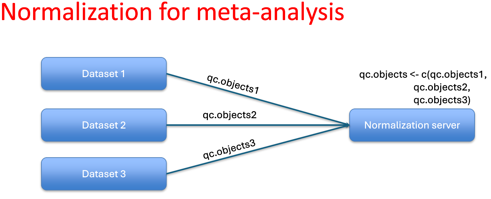
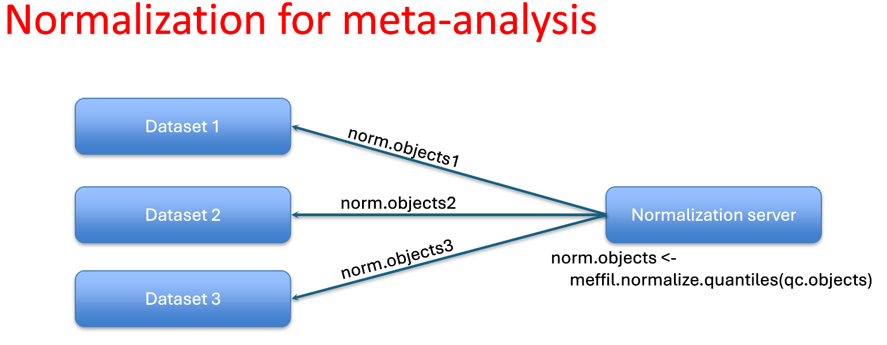

# MODULE STATUS

**Developer:** Developer's team

**Scripts status:** Ready

**Prerequisite scripts:** _Script 0_ and _01a_

**Data upload method:** automated upload to sftp bristol


# Overview: Functional normalization of DNA methylation data across cohorts
Functional normalization is employed to adjust for unwanted variation in methylation data, such as batch effects or technical variation. When datasets are processed separately, combining them for normalization ensures that these biases are corrected across all cohorts, leading to more accurate and comparable results. This method is crucial for large-scale DNA methylation studies where data integration from multiple sources is necessary for comprehensive analysis, e.g., meta-analysis, pooled EWAS analyses where the outcome is confounded with the cohort. To minimize batch-related associations, we will normalize the datasets across all cohorts using quantiles derived from both methylation probes and control probes. 

This module prepares the data for subsequent pooled EWAS analyses. While future analyses will use DataSHIELD for secure, federated processing, the current workflow still relies on the Bristol SFTP system for transferring encrypted results.

We will use the following approach in meffil: [Functional normalizing separate datasets](https://github.com/perishky/meffil/wiki/Functional-normalizing-separate-datasets).

## **Step 1**: Obtain QC objects from each dataset and perform cross-cohort functional normalization.


To obtain shrunk QC objects from your dataset, please run the following command:
```
./01f-normalization.sh -c /path/to/config/file shrink
```
This will generate a `qc_objects_shrink.rda` in `/results/01` and `qc_objects.rda` in `/processed_data/methylation_data`. The `qc_objects_shrink.rda` excludes ID information and should be uploaded to the Bristol SFTP server for cross-cohort functional normalization.


Cross-cohort functional normalisation will be performed on the Bristol SFTP server. The DEEP core team will estimate the optimal number of control probe principal components to include in the normalization and use [meffil.normalize.quantiles()](https://github.com/perishky/meffil/blob/master/R/normalize-quantiles.r) to normalize the pooled objects from all DEEP cohorts. Then, we send the cross-cohort functionally normalized quantiles back to the corresponding cohort.

## **Step 2**: Restore information to normalized QC objects derived from shrunk QC objects  


Please **DO NOT** proceed until you have received the cross-cohort normalized quantiles from Bristol. Once received, please place your `norms.rda` file in the `input_data` folder and then run the following command:
```
./01f-normalization.sh -c /path/to/config/file expand
```