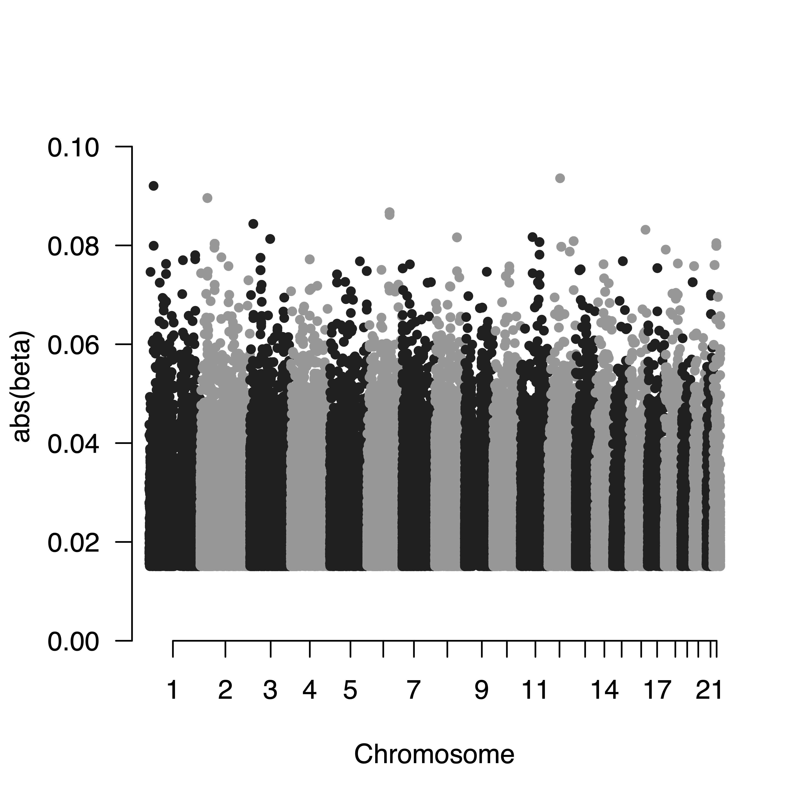
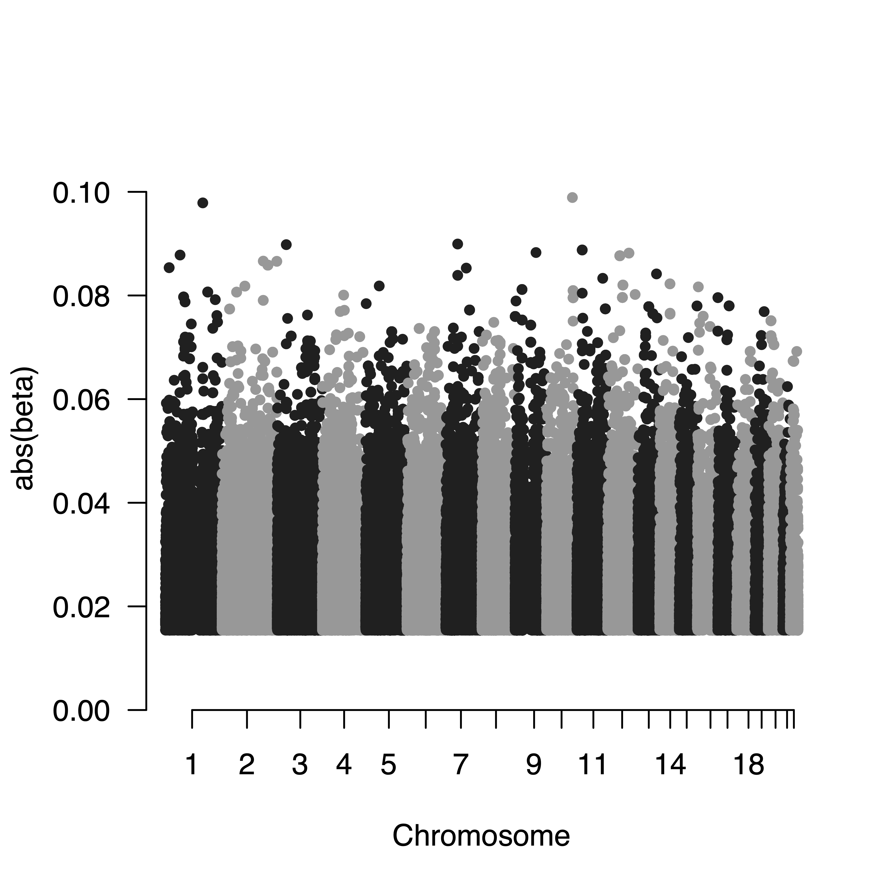
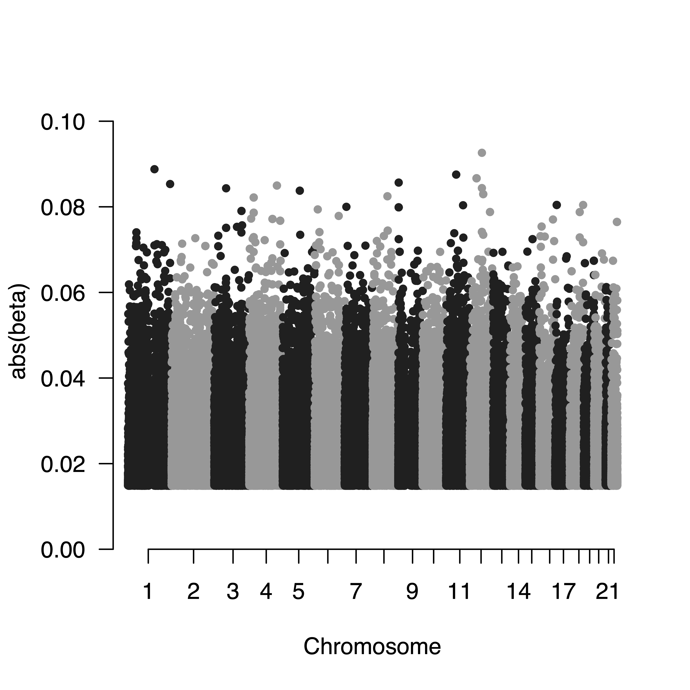
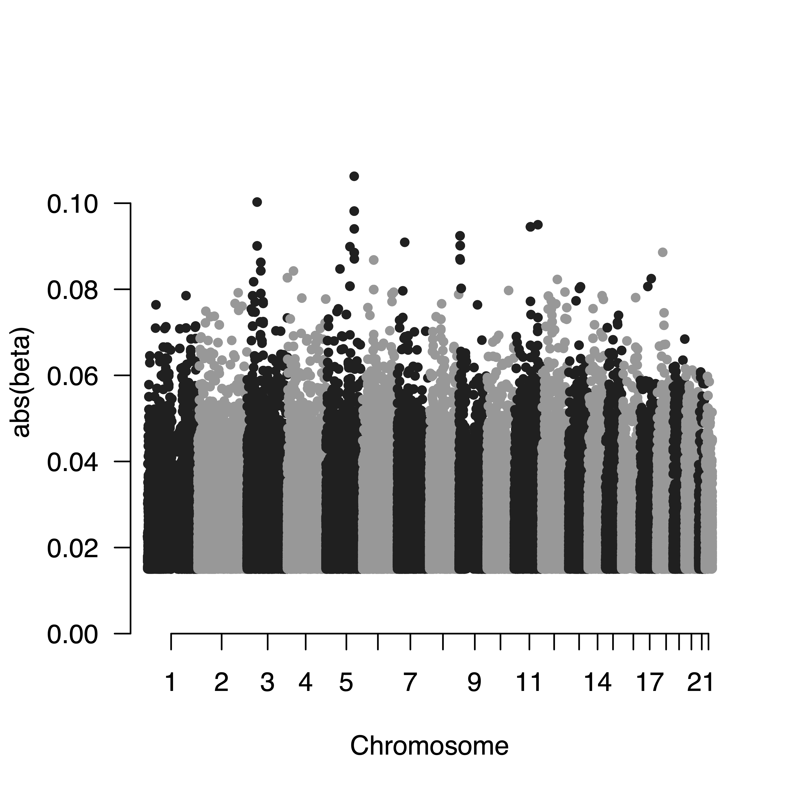
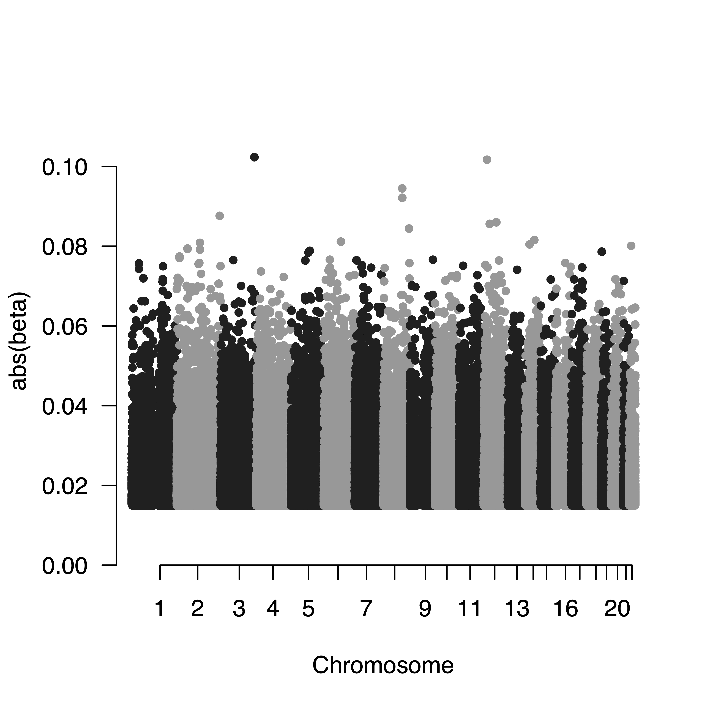

# MODULE STATUS

**Developer:** Developer's team

**Scripts status:** Ready

**Prerequisite scripts:** _Script 0_, _01a_, _01b_, _01c_ and _01d_

**Data upload method:** automated upload to sftp bristol

# Module 01e Overview: Conduct GWAS of genetic PCs
GWAS commonly adjust for population stratification by using PCs as covariates. However, [Grinde (2024)](https://journals.plos.org/plosgenetics/article?id=10.1371/journal.pgen.1011242#sec010) indicates that PCs may capture not only global ancestry but also local genomic features, which can introduce collider bias and lead to spurious associations. Excluding known high LD regions and then conducting strict LD pruning before PCA reduces local artifacts in PCs effectively, while excluding high LD regions alone is insufficient.

In Module 01b, we have generated the genetic PCs by excluding high LD regions and conducting strict LD pruning (`r2 = 0.1` and `window = 10000kb`). Here, we conduct GWAS analysis for genetic PC1 to PC5 respectively, and generate Manhattan plots with absolute beta values as y-axis, to confirm that genetic PCs are valid and do not capture local genomic features.

To run the script, use the following command:
```
./01e-genetic_pc_gwas.sh -c /path/to/config/file
```
>[!IMPORTANT]
> **Please check**
> Please check Manhattan plots. If you found strong local associations, then this will indicate that genetic PCs can't be used in GWAS analyses.

Example outputs:






