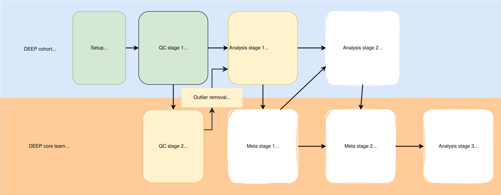

Welcome to the [Diverse Epigenetic Epidemiology Partnership](https://www.deep-epigenetics.org/) analysis pipeline. This wiki will guide you through the different stages of the analysis. We recommend you read this page before you start running the pipeline to familiarise yourself with how it was designed and what it includes, how to use this wiki, and what to do if it goes wrong.

A reminder of our participation requirements can be found on this [**page**](Participation-requirements).

## Design overview

The pipeline is designed to make it as automatic and reproducible as possible, minimising coding and input required by users ("analysts"). This makes the pipeline easy to execute, avoids duplication of effort, maintains consistency across cohorts, and reduces potential for errors. Pipeline stages are separated into numbered modules. Modules need to be completed in sequence. [This flowchart](Script-Flowchart) represents the dependencies between the modules so you can see what order you need to run them in. 

Our collaborative framework follows the principle of federated analysis, where individual-level data remain on local servers, and only non-disclosive summary statistics are shared across cohorts. Each analyst runs the pipeline for their cohort on their own server, e.g., a High-Performance Computing (HPC) server, and uploads encrypted results (incl. summary statistics, plots) to an SFTP server in Bristol.

Analyst input is minimised by using a `config` file and pre-formatted genetic, methylation, phenotype, and covariate data. This config file includes all cohort-specific parameters, such as file paths, properties of the data, thresholds, etc. Details on data formatting are provided in `Data preparation prior to pipeline` Section in the Sidebar: [Imputed genetic data](https://github.com/MRCIEU/DEEP_mqtls/wiki/Imputed-genetic-data), [Normalised methylation data](https://github.com/MRCIEU/DEEP_mqtls/wiki/Normalised-methylation-data), [Covariate data](https://github.com/MRCIEU/DEEP_mqtls/wiki/Covariate-data), and [Phenotype data](https://github.com/MRCIEU/DEEP_mqtls/wiki/Phenotype-data).

## Content overview

The pipeline begins with a series of sequential modules that verify the correct software requirements, genetic data, DNA methylation data, phenotype data, and covariate data. This generates several outputs that analysis modules can use later in the pipeline.

## The QC stages within the pipeline are:
### QC stage 1
Perform QC without removing individuals, such as: checking variant and sample missingness rates, sex-mismatch, performing positive/negative control for mQTL and EWAS.
### QC stage 2
Collect summary-level information from QC stage 1, and perform QC by removing individuals for cross-cohort analysis

## The Analysis stages within the pipeline are:
### Perform an mQTL analysis

Perform a full GWAS on every methylation probe available in the sample. Variations of this analysis will be performed, including:

- a standard mQTL analysis using bestguess imputed SNPs covering the full surface using new software
- cell-type interacting mQTL analyses for abundant cell types
- a var-mQTL analysis, which looks for SNPs that influence the variance of a probe.

### EWAS of cardiometabolic traits

We will be conducting EWASs on a range of complex traits:
- Prevalent Type 2 Diabetes
- Body Mass Index
- Blood Pressure
- Blood glucose
- HbA1c
- Blood lipids
- Smoking (y/n)
- Alcohol intake

### EWAS of child health phenotypes

- Child height
- Child lipids
- Mothers smoking

We will conduct EWASs using the following models:

- standard EWAS
- Variance EWAS
- Cell type interaction EWAS
- DMR analyses

Please note, not all of these modules are ready to be run. Those that are have been included in this repository on the main branch. The others are being developed and will be released once they are ready. You will be notified when new analyses are ready for you to run. 

## How to use the wiki

This wiki is structured to guide you through each stage of the analysis. There is one page per module. At the top of each page is a standard header that lets you know the status of each module (whether it is ready to be run or not), which scripts need to be completed before running this module, and instructions for uploading results at the end. 
Then, the page will describe the analysis performed in the module, and it will give example commands to implement the script. 

**Thank you for reading this guide, and for your partnership in the DEEP study. You are ready to get started!**