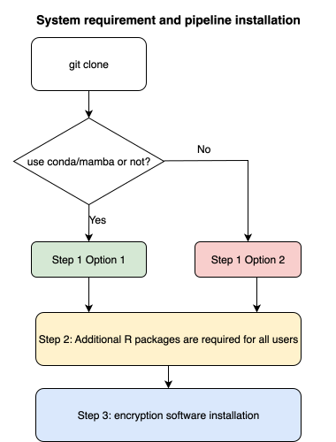

## Approach


This flowchart illustrates the steps required to set up the DEEP pipeline environment. Each analyst runs the pipeline for their cohort on their own server. You will download scripts from GitHub to your HPC server and then run the scripts sequentially. You will need to install dependencies and R packages using one of the options below.


## Download the pipeline scripts from GitHub

To download the pipeline scripts, you need to make sure you have Git installed. 

```
which git
```

You will then need to run the following git command to download the scripts from the DEEP repository:

    git clone https://github.com/MRCIEU/DEEP_mqtls.git

This will create a new directory called `DEEP_mqtls` in your current folder and contains the files needed to run the analysis, [i.e. those listed here](https://github.com/MRCIEU/DEEP_mqtls).

Ideally, you should clone the scripts to a location on your server that you can interact with and which is visible to your compute nodes. Please contact us if you have any questions about this.

Because this is a `git` repository it means that it is very easy for you to update these files if we need to make any changes to the code, for example to fix bugs. In order to update the scripts you simply run 

```
git pull
```

from within your cloned repository.

We recommend that you do this frequently to ensure you are up to date. If you are up to date you will see the message: 

```
Already up to date.
```

Please note, do not make any changes to the files cloned from GitHub into this folder. If you do, you won't be able to `git pull` very easily.

## Set up of main environment for DEEP pipeline

The pipeline scripts require `R version 4.1` or higher, `Python 3 version 3.9 or higher`, `Python 2.7`, and any distribution of `Java 11`. There are two options to install the necessary dependencies and R-packages:

### Step 1 Option 1: Create and activate conda/mamba environments (recommended) 
[conda/mamba](https://github.com/conda-forge/miniforge?tab=readme-ov-file) environments allow you to manage the environment while running this pipeline, eg, they ensure that the correct dependency versions are used for the DEEP pipeline scripts. 

For DEEP, we generated two different environments: `deep_env` for most of the QC and analyses, and `hase_py2` for the mQTL analyses.
The `deep_env` environment will require ~4 GB of storage, and the `hase_py2`environment will require ～600 MB. Before installation, please make sure that no environments with the same names (`deep_env` or `hase_py2`) already exist in your conda/mamba environment list 
and that you have [conda/mamba](https://github.com/conda-forge/miniforge?tab=readme-ov-file) **installed** and **initialised** before running these commands:
```
# 1. Check that no duplicate environment names are used before creating our environment.
# If you see 'deep_env' or 'hase_py2' in the list, rename or remove them first.
mamba env list

# 2. To create the main environment for DEEP pipeline
mamba env create --file deep_env.yml

# 3. To create the python2 environment to run meQTL analysis
mamba env create --file ./resources/bin/hase/environment.yml
```
If you use conda, please replace `mamba` with `conda` in all commands. 

In the location on your server where you have cloned this repository, you need to run:

```bash
mamba activate deep_env
wget http://homepages.uni-regensburg.de/~wit59712/easyqc/EasyQC_9.2.tar.gz
```
If you are working on an HPC system, **do NOT load any system-wide R module** (e.g., `module load languages/R/4.5.1`), because it may allow R to use packages outside your conda environment.

After starting R, run:
```
.libPaths()
```
Please ensure it returns the first path, which points to the R library inside your conda environment, e.g., `/user/home/user_name/miniforge3/envs/deep_env/lib/R/library`

Then install the packages in R:
```r
install.packages("parallel")
install.packages("EasyQC_9.2.tar.gz")
``` 

Then you need to install several other R packages (EpiDish, meffonym, meffil etc). 

**Please proceed to "Step 2: Other R packages are required for both mamba users and non-mamba users".**

### Step 1 Option 2: Manual installation of dependencies and R-packages (if you do not use mamba/conda)

Please ensure you have AT LEAST:

* `R version 4.1`
* `Python3 version 3.9 or higher` and any distribution of `Java 11` for Hail. To install Hail, please refer to [Hail installation website](https://hail.is/docs/0.2/getting_started.html).
* `Python 2.7` for Hase

#### If you don't use conda or mamba, please install these R packages in your R manually:
```
# Navigate to the project directory
cd DEEP_mqtls

# Download EasyQC 
wget http://homepages.uni-regensburg.de/~wit59712/easyqc/EasyQC_9.2.tar.gz
```

```
# Enter into your R
R
# Define the list of required CRAN packages
pkgs <- c(
  "MASS", "lattice", "ggplot2", "ggExtra", "data.table", 
  "MatrixEQTL", "parallel", "parallelly", "matrixStats", 
  "Matrix", "sparsesvd", "remotes", "plyr", "Cairo", 
  "plotrix", "viridis", "cluster", "RPMM", "tibble", 
  "vioplot", "qqman", "ggtext", "diptest", "mixtools", 
  "corrplot", "janitor", "tidyr", "dplyr", "readr", 
  "ggpubr", "ggrepel", "magrittr", "R.utils", 
  "BiocManager", "DescTools", "gridExtra"
)

# Install missing packages only (skips those already installed)
new_pkgs <- pkgs[!(pkgs %in% installed.packages()[,"Package"])]
if(length(new_pkgs)) install.packages(new_pkgs)

# Install the local EasyQC file
# You MUST include repos=NULL and type="source" for local .tar.gz files
if (file.exists("EasyQC_9.2.tar.gz")) {
  install.packages("EasyQC_9.2.tar.gz", repos = NULL, type = "source")
} else {
  warning("EasyQC_9.2.tar.gz not found in current directory!")
}
```

### You need to test whether R can find the path to your R libraries

You can test this in R:

```r
library(ggplot2)
```

If this doesn't work, then you may need to add the following line to your `.bashrc` file:

Open your `.bashrc`
```
nano ~/.bashrc
```
Add the following line to your `.bashrc` 

```
export R_LIBS="/path/to/library/"
```

Restart the terminal, and any R-script should automatically look for packages in your specified directory. You can test this by opening R and testing a library

```r
library(ggplot2)
```

#### You also need to make sure the scripts in the pipeline can find Rscript

You can test this by typing

`Rscript`

If this doesn't work, then you need to add the following line to your `bashrc` file

```
#You need to edit the line
export PATH="$PATH:/path/to/directory/R-4.1.2/bin/"
```


## Step 2: Other R packages are required for BOTH mamba users and non-mamba users.
### For users using conda/mamab, please activate the DEEP environment before running the following commands
```
mamba activate deep_env
```
### Troubleshoot BiocManager
When installing Bioconductor packages, you may encounter an error like:
```
Error: Bioconductor version '3.14' requires R version '4.1'; use
  `BiocManager::install(version = '3.20')` with R version 4.4; see
  https://bioconductor.org/install
```
To avoid this, please manually specify the BiocManager version:
```
BiocManager::install(version = "3.14") # for R 4.1
BiocManager::install(version = "3.20") # for R 4.4
BiocManager::install(version = "3.21") # for R 4.5
BiocManager::install(version = "3.22") # for R 4.5.2
```

### Please install EpiDISH and DunedinPACE from GitHub and not from Bioconductor.
```r
library(remotes)
library(BiocManager)
Sys.setenv(R_REMOTES_NO_ERRORS_FROM_WARNINGS="true")
BiocManager::install("genefilter")
remotes::install_github("sjczheng/EpiDISH")
remotes::install_github("danbelsky/DunedinPACE")
```

### Please install GwasDataImport to infer genome build
```r
library(BiocManager)
if (!requireNamespace("restfulr", quietly = TRUE)) {
  BiocManager::install("restfulr")
}
BiocManager::install("rtracklayer")
BiocManager::install("biomaRt")
BiocManager::install("VariantAnnotation")
BiocManager::install("GenomeInfoDb")
remotes::install_github("mrcieu/gwasvcf")
remotes::install_github("MRCIEU/GwasDataImport")
```

### Please install EWAFF
```r
library(remotes)
Sys.setenv(R_REMOTES_NO_ERRORS_FROM_WARNINGS="true")
remotes::install_github("perishky/ewaff")
```
### Please install scoreInvHap and impute from BiocManager
```r
library(BiocManager)
BiocManager::install("scoreInvHap")
BiocManager::install("impute")
```

### Please install these packages if you have related or admixed samples
```r
library(BiocManager)
BiocManager::install("GWASTools")
BiocManager::install("SNPRelate")
BiocManager::install("GENESIS")
BiocManager::install("BiocParallel")
```
### Please install meffonym
```r
library(remotes)
install_github("perishky/meffonym")

```
### You need to install meffil. You need to have version 1.5.0 or higher. You can find out the version with the commands below. 
```
library(meffil)
sessionInfo()
```

Firstly, install some of the dependencies:
```r
BiocManager::install("SmartSVA")
BiocManager::install("base64")
BiocManager::install("illuminaio")
BiocManager::install("limma")
BiocManager::install("DNAcopy")
BiocManager::install("preprocessCore")

#Then install meffil in R:
library(remotes)
Sys.setenv(R_REMOTES_NO_ERRORS_FROM_WARNINGS="true")
remotes::install_github("perishky/meffil")
```

### You need to test whether the preprocessCore R package multi-threading works
```r
threading.ok <- function() {
	require(preprocessCore)
	y <- matrix(10+rnorm(100),20,5)
	ret <- tryCatch({normalize.quantiles(y); "correct"}, error=function(e) e$message)
	!grepl("pthread_create", ret)
}
threading.ok()
```
If `threading.ok()` returns TRUE, then you shouldn't have a problem. If it returns FALSE, then you'll need to reinstall `preprocessCore` with threading disabled as shown below:

```r
BiocManager::install("preprocessCore", configure.args="--disable-threading", force=TRUE)
```
If you still encounter the error about the `preprocessCore` and under the conda environment, please manually install it by following:
```
git clone https://github.com/bmbolstad/preprocessCore.git
R CMD INSTALL --configure-args="--disable-threading" path/to/preprocessCore
``` 


#### You need to test whether you are able to generate plots in R
Open R and type

```
 capabilities()
```
png should be TRUE

### Step 3: Please ensure you have encryption software installed

We encrypt and upload results using **AES encryption** with the following tools:

- `gpg`
- `pinentry`
- `sshpass`

Regardless of whether you are using **mamba/conda** or **not**, please **manually install all three tools** on your system. If you are using mamba/conda, please activate your environment first:

```
mamba activate deep_env
```
Please install gpg from here: [https://gnupg.org/download/](https://gnupg.org/download/); 
pinentry from here: [https://www.gnupg.org/download/index.html#pinentry](https://www.gnupg.org/download/index.html#pinentry); 
sshpass from here: [https://www.cyberciti.biz/faq/noninteractive-shell-script-ssh-password-provider/](https://www.cyberciti.biz/faq/noninteractive-shell-script-ssh-password-provider/). 
After installation, please check:
```
which sshpass
which gpg
which pinentry
```

 


