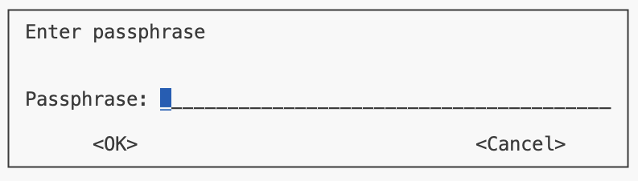

# MODULE STATUS

**Developer:** Developer's team

**Scripts status:** Ready

**Prerequisite scripts:** _Script 0_, _01a_, _01b_, _01c_, _01d_, _01e_, and _01f_

**Data upload method:** Upload to the Bristol SFTP server

# Check and upload the encrypted summary data to the Bristol SFTP server
To check if you have successfully finished the whole module 01, please run this command:
```
./check_upload.sh -c /path/to/config/file 01 check
```
To encrypt and upload the results to the Bristol SFTP server
```
./check_upload.sh -c /path/to/config/file 01 upload
```
>[!IMPORTANT]
> **Please check**
The upload script packages all files in `results/01`. Although the check script may warn about certain file contents, users **MUST** ensure that no individual-level data remains in results/01 to avoid uploading sensitive information.
For example, the 01b script generates the smiss file, which contains individual IDs, in results/01 and then moves it to `processed_data/genetic_data`. The check script will prompt you to confirm that smiss is in `processed_data/genetic_data` rather than in `results/01`.
> **Enter your encryption password**

After running the upload script, you will be prompted to enter your encryption password. Please copy and paste the password provided by Hannah during the [Pipeline set up](https://github.com/MRCIEU/DEEP_mqtls/wiki/Install-and-set-up) registration step.

# Example output of the check command:
The check will return a message similar to the following:
```
Already up to date.
-----------------------------------------------
 
Using config located at: /path/to/config/file

-----------------------------------------------
found deep_env environment in mamba
Using mamba to run the script
 
Checking log files for 01
Version required: 1.0.0
Version used:    1.0.0
Correct script version
01a-check_data.sh completed successfully.
Version required: 1.0.0
Version used:    1.0.0
Correct script version
01b-process_genetic_data.sh completed successfully.
Version required: 1.0.0
Version used:    1.0.0
Correct script version
Checking for pattern: Successfully completed script 01c methy_outlier chunk
Checking for pattern: Successfully completed script 01c check_phenotype chunk
Checking for pattern: Successfully completed script 01c predict_age_smoking chunk
Checking for pattern: Successfully completed script 01c cell_counts chunk
Checking for pattern: Successfully completed script 01c ewas chunk
Checking for pattern: Successfully completed script 01c meth_pcs chunk
Checking for pattern: Successfully completed script 01c combine_covariates chunk
Successful chunks: 7/7
01c-check_phenotypes_and_methylation.sh completed successfully.
Version required: 1.0.0
Version used:    1.0.0
Correct script version
01d-mqtl_controls.sh completed successfully.
Version required: 1.0.0
Version used:    1.0.0
Correct script version
01e-genetic_pc_gwas.sh completed successfully.
 
Checking results for 01
Cohort descriptives file present
Age distribution plot file present
SNP chromosome distribution files present
Quality scores plot file present
Sex prediction plot file is absent. Please check that the samples are of a single sex (e.g., all male or all female).
Inferred build file present
PCA plot present
Global PCA plot present
easyQC plot and results present
Allele frequency file present
HWE file present
Imputation quality file present
Sample missingness file present in processed_data folder
Three methylation_summary RData files are present
cohort_descriptives_was.RData is present
Summary statistics of cell counts are present
Plots of cell counts are present
Ori and combined correlation plots of cell counts are present
Correlation matrix of observed vs predicted cell counts is present
cellcounts_comp folder contains 15 PDF files
Smoking and age prediction plot is present
The meth PCs plots are present
The pc_var_association plot is present
EWAS stats file present
EWAS report file present
Raw and edited phenotypes summary files are present
Filtered positive control file is present in processed_data folder
Checking positive control: cg07959070
positive control cg07959070 results present
positive control cg07959070 Manhattan plot present
positive control cg07959070 no cis chromosome Manhattan plot present
positive control cg07959070 QQ plot present
positive control cg07959070 no cis chromosome QQ plot present
Checking negative control: NEG_cg07959070
negative control NEG_cg07959070 results present
negative control NEG_cg07959070 Manhattan plot present
negative control NEG_cg07959070 no cis chromosome Manhattan plot present
negative control NEG_cg07959070 QQ plot present
negative control NEG_cg07959070 no cis chromosome QQ plot present
...
GWAS PC1 results present
GWAS PC1 beta Manhattan plot present
GWAS PC2 results present
GWAS PC2 beta Manhattan plot present
GWAS PC3 results present
GWAS PC3 beta Manhattan plot present
GWAS PC4 results present
GWAS PC4 beta Manhattan plot present
GWAS PC5 results present
GWAS PC5 beta Manhattan plot present
 
Section 01 has been successfully completed!
```

